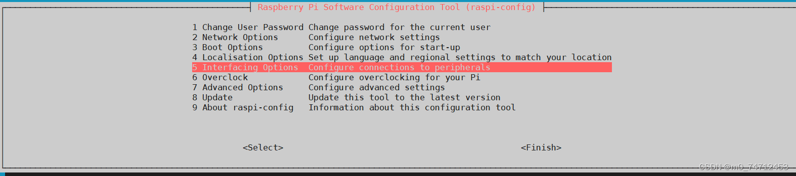

[English](../en/05-imx219-csi-raspberry-pi.md) | [Deutsch](../de/05-imx219-csi-raspberry-pi.md) | [Español](../es/05-imx219-csi-raspberry-pi.md) | Français | [Italiano](../it/05-imx219-csi-raspberry-pi.md) | [日本語](../ja/05-imx219-csi-raspberry-pi.md) | [한국어](../ko/05-imx219-csi-raspberry-pi.md) | [Português (BR)](../pt-br/05-imx219-csi-raspberry-pi.md) | [Português (PT)](../pt-pt/05-imx219-csi-raspberry-pi.md) | [简体中文](../zh-hans/05-imx219-csi-raspberry-pi.md) | [繁體中文](../zh-hant/05-imx219-csi-raspberry-pi.md)

# 05、Tutoriel sur la caméra IMX219\-CSI (Raspberry Pi)

##### 1、Utilisez d'abord la commande "ls" pour vérifier si le nœud de périphérique vchiq existe : saisissez ls /dev

S'il n'existe pas, un problème peut provenir du noyau ou du matériel du périphérique ; essayez de réinstaller le système ou de remplacer le matériel.

##### 2、Exécutez la commande "sudo raspi\-config" pour activer la caméra CSI du Raspberry Pi

Quittez ensuite et saisissez la commande sudo reboot pour redémarrer le Raspberry Pi

##### 3、Saisissez "vcgencmd get\_camera" pour vérifier si la caméra actuelle et son activation sont disponibles

Si detected=0, cela signifie que le module de caméra est mal connecté ; vérifiez à nouveau le matériel. detected=1 signifie que la caméra CSI est correctement connectée. supported=1 signifie que la caméra est activée et peut être utilisée. supported=0 signifie que la caméra CSI n'est pas activée et que le module de caméra doit être activé.

## **3\.Utilisez la commande rapistill pour prendre une photo**

Saisissez **"raspistill \-o image\.jpg"** pour prendre et enregistrer une photo avec succès ; la caméra s'allume alors en rouge. Pour plus de paramètres, utilisez raspistill \-\-help

Transférez l'image image\.jpg sur le bureau Windows et ouvrez-la pour voir le résultat de la photo

