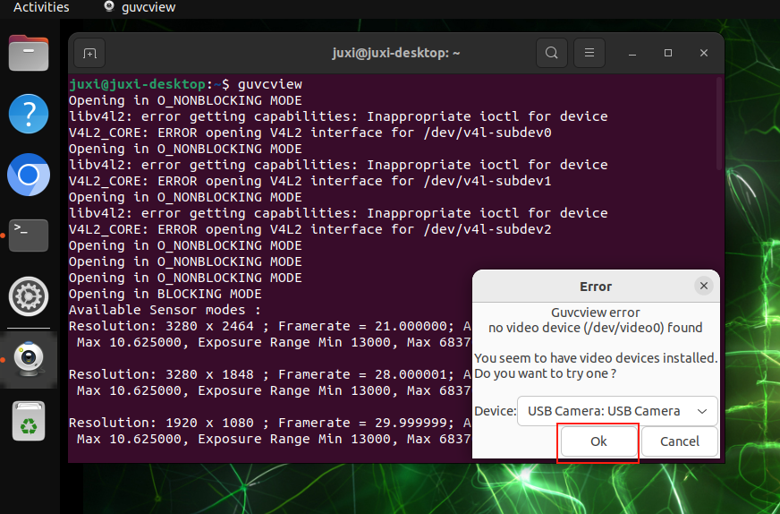
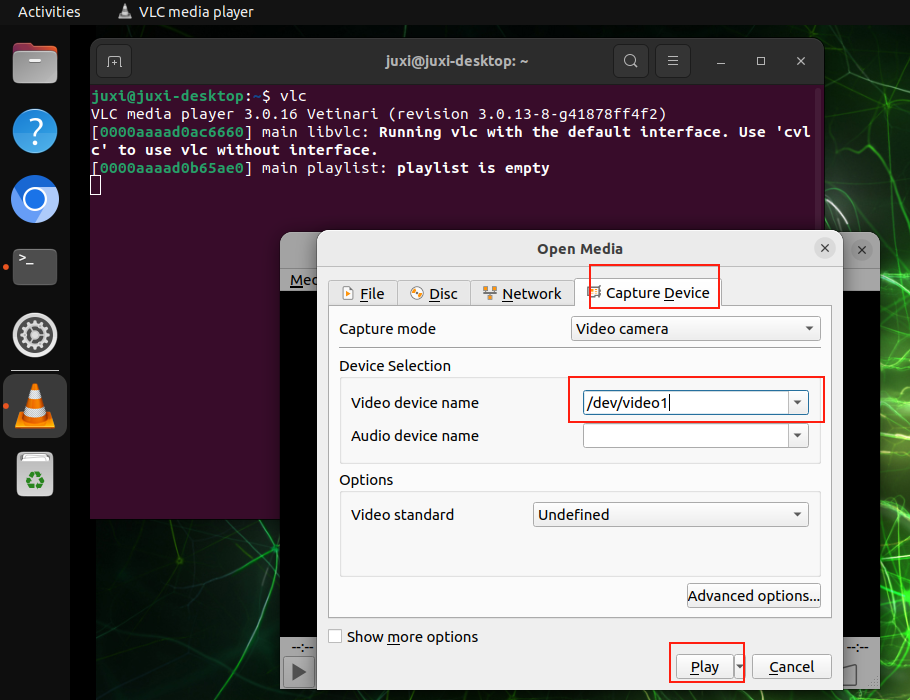

[English](../en/02-autofocus-camera-usage.md) | [Deutsch](../de/02-autofocus-camera-usage.md) | [Español](../es/02-autofocus-camera-usage.md) | [Français](../fr/02-autofocus-camera-usage.md) | Italiano | [日本語](../ja/02-autofocus-camera-usage.md) | [한국어](../ko/02-autofocus-camera-usage.md) | [Português (BR)](../pt-br/02-autofocus-camera-usage.md) | [Português (PT)](../pt-pt/02-autofocus-camera-usage.md) | [简体中文](../zh-hans/02-autofocus-camera-usage.md) | [繁體中文](../zh-hant/02-autofocus-camera-usage.md)

# 02. Uso della fotocamera con autofocus

## 1. Visualizzare il dispositivo video

```Plain Text
ls /dev/video*
```

Il risultato dell'immagine corrisponde a due fotocamere CSI e una fotocamera USB collegate: di norma una fotocamera CSI mostra un dispositivo `video`, una fotocamera USB mostra due dispositivi `video`, e per la fotocamera USB si seleziona il `/dev/video2` appena aggiunto e con numero inferiore (collegando la fotocamera USB il sistema aggiunge i numeri di dispositivo `/dev/video2` e `/dev/video3`)


## 2. GUVCView

GUVCView è un software open source per sistemi Linux, utilizzato per catturare e registrare video e immagini, principalmente per webcam.

### 2\.1. Installazione di GUVCView

```Plain Text
sudo apt update
sudo apt install guvcview -y
```


### 2\.2. Uso di GUVCView

Accedere alla barra dei menu delle applicazioni e fare clic sull'icona `guvcview`, oppure digitare il comando di avvio nel terminale: selezionare la fotocamera USB; la fotocamera CSI non mostra l'anteprima

```Plain Text
guvcview
```




## 3. VLC

VLC media player è un lettore multimediale libero e open source che supporta vari formati audio e video, nonché DVD, CD audio, VCD e diversi protocolli di streaming.

### 3\.1. Installazione di VLC

```Plain Text
sudo apt update
sudo apt install vlc -y
```


### 3\.2. Uso di VLC

Accedere alla barra dei menu delle applicazioni e fare clic sull'icona `VLC media player`, oppure digitare il comando di avvio nel terminale: selezionare la fotocamera USB; la fotocamera CSI non mostra l'anteprima

```Plain Text
vlc
```


Selezionare il numero di dispositivo corrispondente alla fotocamera USB:




