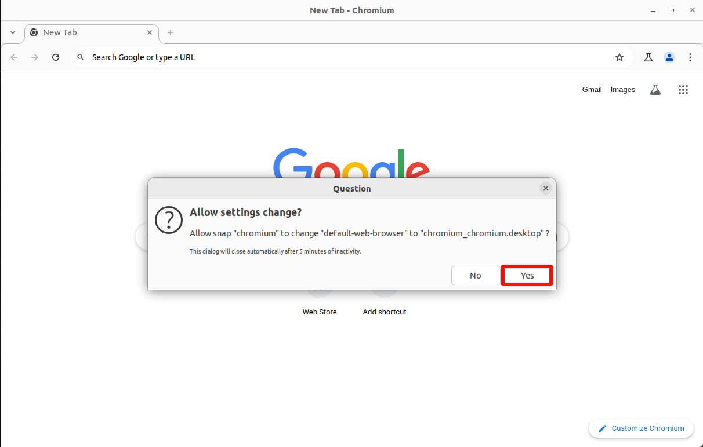
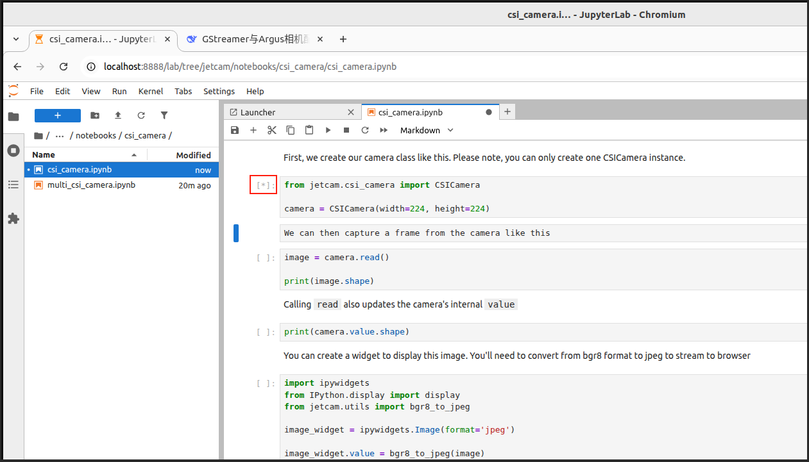
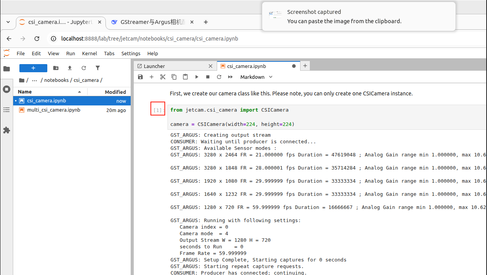

[English](../en/03-jupyterlab-usage.md) | [Deutsch](../de/03-jupyterlab-usage.md) | [Español](../es/03-jupyterlab-usage.md) | [Français](../fr/03-jupyterlab-usage.md) | Italiano | [日本語](../ja/03-jupyterlab-usage.md) | [한국어](../ko/03-jupyterlab-usage.md) | [Português (BR)](../pt-br/03-jupyterlab-usage.md) | [Português (PT)](../pt-pt/03-jupyterlab-usage.md) | [简体中文](../zh-hans/03-jupyterlab-usage.md) | [繁體中文](../zh-hant/03-jupyterlab-usage.md)

# 03. Uso di Jupyter Lab

## 1. Installazione di Jupyter Lab

### 1\.1. Jupyter Lab

Utilizzare il seguente comando per installare Jupyter Lab: se la velocità di download di Jupyter Lab è lenta, è possibile utilizzare una fonte specifica per l'installazione

```Plain Text
sudo apt update
sudo apt install python3-pip -y
sudo pip3 install --upgrade pip
```

```Plain Text
sudo pip3 install jupyterlab
# Fonte Tsinghua: pip3 install jupyterlab -i https://pypi.tuna.tsinghua.edu.cn/simple
# Fonte Alibaba Cloud: sudo pip3 install jupyterlab -i https://mirrors.aliyun.com/pypi/simple/
```


### 1\.2. Node\.js

Utilizzare il seguente comando per installare la versione più recente di Node\.js:

```Plain Text
sudo apt install curl -y
sudo curl -fsSL https://deb.nodesource.com/setup_22.x | sudo -E bash -
sudo apt install nodejs -y
```


Verificare la versione:

```Plain Text
node -v && npm -v
```


## 2. Avvio di Jupyter Lab

Prima di avviare Jupyter Lab è necessario impostare il browser predefinito del sistema; in caso contrario, all'avvio del terminale compariranno alcuni avvisi.

### 2\.1. Impostazione del browser predefinito

Aprire il browser Chromium di sistema e selezionare l'opzione per impostarlo come browser predefinito:




### 2\.2. Avvio di Jupyter Lab

```Plain Text
jupyter lab
# Avvio senza browser: jupyter lab --no-browser
# Avvio come amministratore: sudo jupyter lab --allow-root
```


### 2\.3. Accesso dalla macchina host

La macchina host si riferisce all'accesso dal sistema della scheda Jetson, direttamente tramite [http://localhost:8888/](http://localhost:8888/):

`http://localhost:8888/`


## 3. Configurazione di Jupyter Lab

Configurare in Jupyter Lab l'accesso dalla rete locale, la password di accesso, l'avvio automatico all'avvio del sistema e altre operazioni.

### 3\.1. Accesso dalla rete locale

Impostare i dispositivi che si trovano sulla stessa rete locale in modo che possano accedere digitando IP:8888 nel browser!

**Nota: la rete locale di una rete campus di norma non consente l'accesso; è possibile provare passando a un portatile o a un hotspot mobile**

Ad esempio, l'IP della scheda: 192\.168\.0\.105; possiamo accedere al Jupyter Lab della scheda digitando 192\.168\.0\.105:8888 in un browser sulla stessa rete locale

#### 3\.1\.1. Creazione del file di configurazione

```Plain Text
sudo jupyter lab --generate-config
```

Posizione del file di configurazione generato automaticamente: Writing default config to: /root/\.jupyter/jupyter\_lab\_config\.py

#### 3\.1\.2. Modifica del file di configurazione

```Plain Text
sudo gedit /root/.jupyter/jupyter_lab_config.py
```

Modificare il contenuto: dopo la modifica, fare clic su salva e chiudere il file.

Verificare se davanti al codice è presente o meno il simbolo \#, per garantire che la configurazione abbia effetto

```Plain Text
# Consentire alle richieste di qualsiasi origine di accedere al server Jupyter Lab
c.ServerApp.allow_origin = '*'
# 0.0.0.0 indica il binding di tutte le interfacce di rete disponibili, consentendo l'accesso da qualsiasi indirizzo
c.ServerApp.ip = '0.0.0.0'
# Consentire l'avvio del server Jupyter Lab come utente root
c.ServerApp.allow_root = True
# Modificare la porta predefinita per evitare conflitti
c.ServerApp.port = 8888
```


### 3\.2. Configurazione della password di accesso

Digitare nel terminale il comando per impostare la password; è necessario inserirla due volte; durante l'inserimento la password non viene mostrata \!

```Plain Text
sudo jupyter lab password
```

Posizione del file di configurazione generato automaticamente: \[JupyterPasswordApp\] Wrote hashed password to /root/\.jupyter/jupyter\_server\_config\.json


### 3\.3. Servizio di avvio automatico

#### 3\.3\.1. Modifica del file di servizio

```Plain Text
sudo gedit /etc/systemd/system/jupyterlab.service
```

Aggiungere il contenuto: dopo l'aggiunta, fare clic su salva e chiudere il file

```Plain Text
[Unit]
Description=jupyterlab
After=network.target
[Service]
Type=simple
ExecStart=/usr/local/bin/jupyter-lab
config=/root/.jupyter/jupyter_lab_config.py --no-browser
User=root
Group=root
WorkingDirectory=/home/jetson/
Restart=always
RestartSec=10
[Install]
WantedBy=multi-user.target
```

root: il nome utente del sistema

ExecStart: il comando per avviare Jupyter lab; modificarlo con il percorso di installazione di JupyterLab

config: modificarlo con il percorso del file di configurazione di JupyterLab

WorkingDirectory: la directory di lavoro aperta all'avvio di Jupyter\-lab; è possibile modificarla autonomamente (si consiglia di modificarla con la directory dell'utente)

`Visualizzare il percorso di installazione di Jupyter-lab: which jupyter-lab`

`Percorso del file di configurazione: fare riferimento al percorso del file di configurazione generato sopra`


#### 3\.3\.2. Impostazione del servizio di avvio automatico

##### Servizio di avvio automatico

```Plain Text
sudo systemctl enable jupyterlab
# Disattivare l'avvio automatico: systemctl disable jupyterlab
```

##### **Avviare il servizio**

```Plain Text
sudo systemctl start jupyterlab
# Arrestare il servizio: sudo systemctl stop jupyterlab
```

##### **Visualizzare lo stato del servizio**

```Plain Text
systemctl status jupyterlab
```


##### Verifica dell'avvio automatico

Dopo aver riavviato il sistema, in base all'IP del sistema, utilizzare un dispositivo sulla stessa rete locale per accedere all'IP della scheda:8888.

> Al primo accesso è necessario inserire la password; la password è l'informazione impostata nei passi precedenti;
> 
> Al momento dello screenshot l'IP della scheda era 192\.168\.0\.105, quindi i dispositivi sulla stessa rete locale possono accedere a 192\.168\.0\.105:8888
> 
> 


## 4. Uso di Jupyter Lab

### 4\.1. Kernel

Si consiglia di riavviare il kernel e cancellare le informazioni di output di tutte le celle ogni volta che si esegue il programma o in caso di anomalie del programma:


### 4\.2. Esecuzione del programma

Aprire con Jupyter Lab il file di programma da eseguire; all'esecuzione, le celle vengono eseguite dall'alto verso il basso in ordine:

#### 4\.2\.1. In esecuzione

Il simbolo \[\*\] visualizzato in alto a sinistra della cella indica che è in esecuzione:



#### 4\.2\.2. Esecuzione completata

Il \[numero\] visualizzato in alto a sinistra della cella indica il numero d'ordine di esecuzione: ad esempio \[1\] → il programma ha eseguito il codice di quella cella alla prima esecuzione




